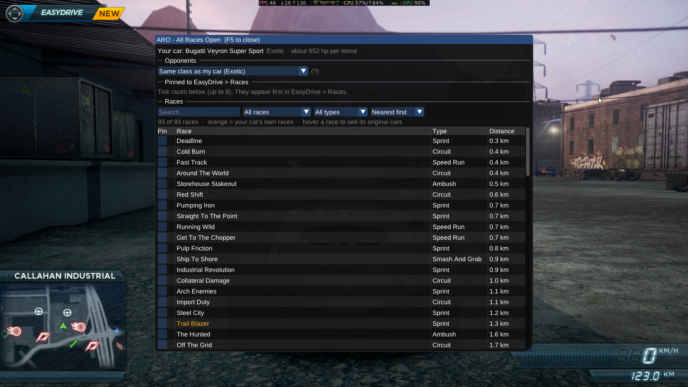
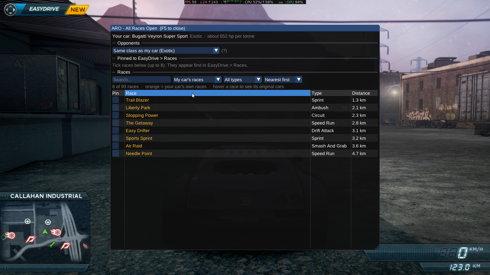
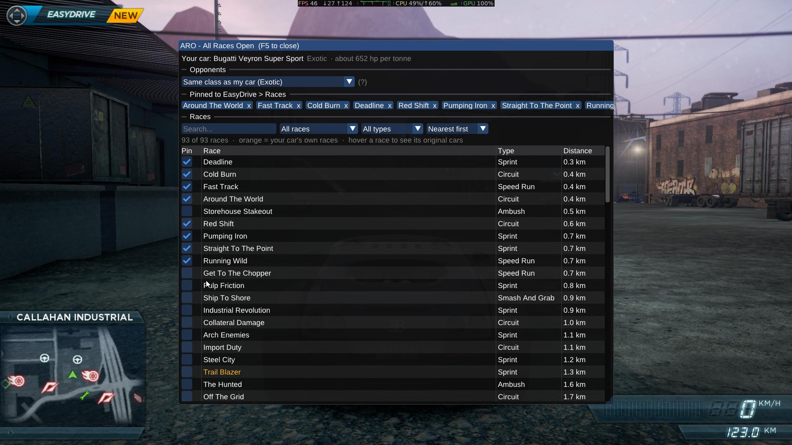

# All Races Open [ARO]

A mod for Need for Speed: Most Wanted (2012) on PC.

In the normal game each car only gets its own handful of races. ARO opens every race to every car,
and adds a small menu (F5) so you can find and pick races easily.

## What it does

- Every race works with every car. The map shows the 20 races closest to you.
- You still only get parts when you win a race in the car it was made for. Other cars get Speed Points.
- F5 menu with all 93 races: names, types, distance, search and filters.
- Pin up to 8 races and they show up at the top of EasyDrive > Races.
- Pick who you race against: cars from your class, any class you want, or "real-world match"
  (cars with similar real-life power-to-weight to yours).
- Most Wanted races, jack spots and parked cars are left alone.

## Screenshots

| | |
|---|---|
|  |  |
|  |  |

## Download

Get `ARO.zip` from the [latest release](https://github.com/dougbug589/All-Races-Open-ARO/releases/latest).

## Install

1. Get `Ultimate-ASI-Loader.zip` (the 32-bit one) from
   [ThirteenAG's releases](https://github.com/ThirteenAG/Ultimate-ASI-Loader/releases/latest)
   and put `dinput8.dll` next to `NFS13.exe`.
2. Unzip `ARO.zip` into the game folder. It has a `scripts` folder inside.
3. On Linux / Steam Deck, set the launch options to `WINEDLLOVERRIDES="dinput8=n,b" %command%`.

Press F5 in free roam to open the menu. Settings are in `scripts/ARO.ini`.
Play offline with it.

## Known issues

- The AI doesn't get faster when it gets a faster car. Opponents in fast cars can still fall behind.
  I tried swapping their cars and even giving them the Most Wanted boss driver, and neither helped.
  The game seems to limit AI speed somewhere in each race's settings, which I haven't found yet.
- EasyDrive can only show 8 races, so you can only pin 8.

## Plans

- AI that keeps up with your car (the big one)
- Custom number of laps and opponents

## Building

You need `mingw-w64-gcc`. Run `./build.sh` and the files end up in `dist/scripts/`.
`tools/gen_cars.py` rebuilds the car list from the game files. Notes on the game internals are in `NOTES.md`.

## Credits

MIT licence. Uses [Dear ImGui](https://github.com/ocornut/imgui) and [miniz](https://github.com/richgel999/miniz)
(both MIT). Made with help from Claude.
