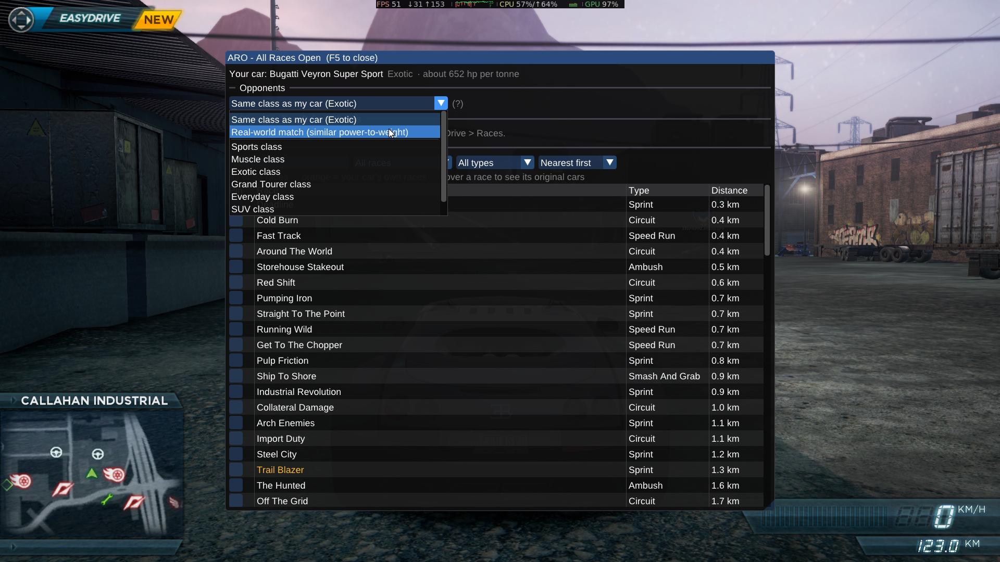
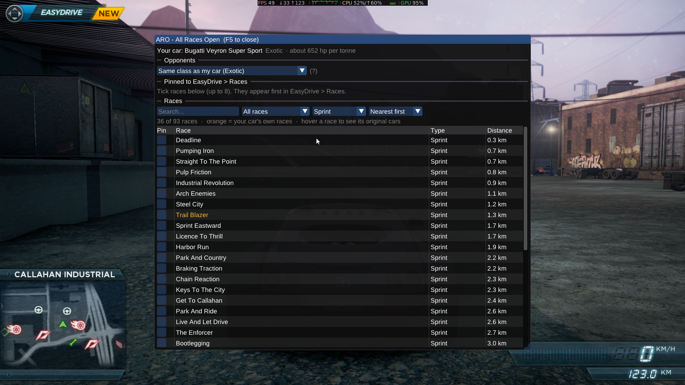
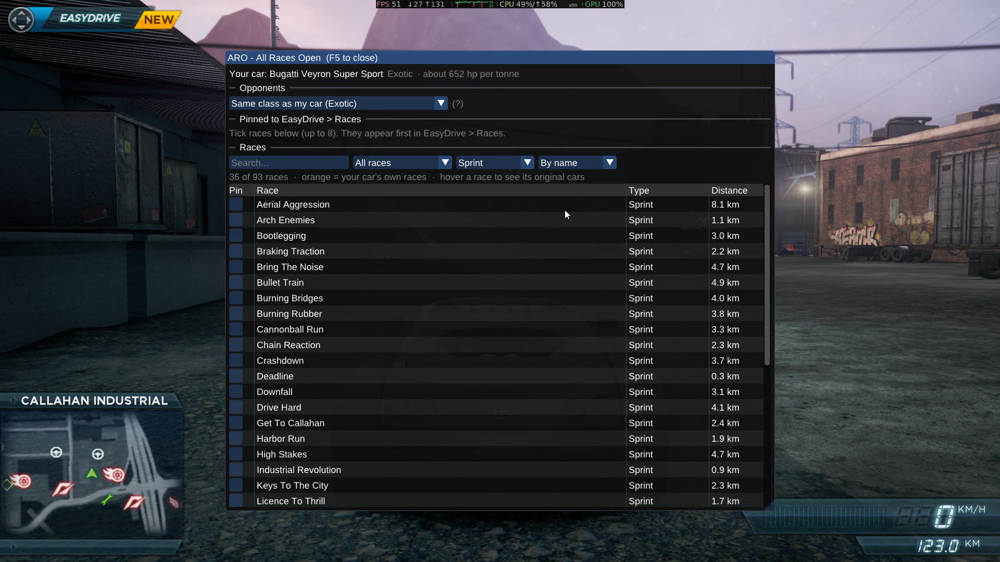
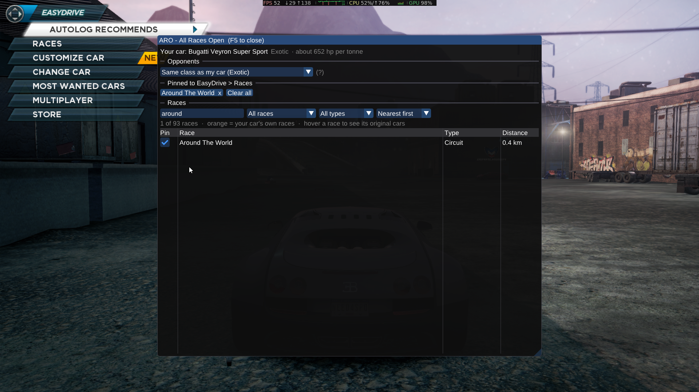
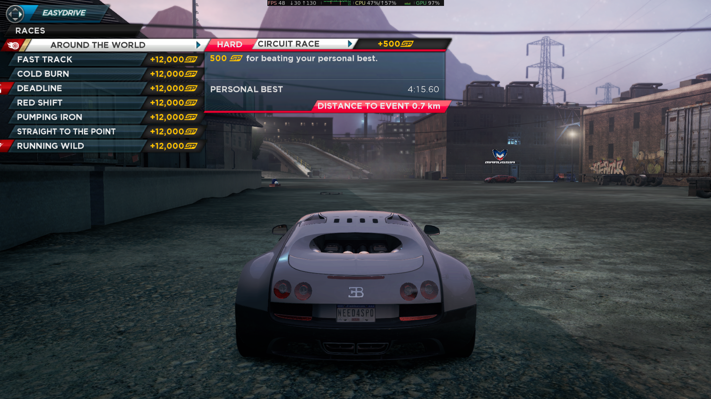

# All Races Open [ARO]

![All Races Open [ARO]](assets/banner.jpg)

By freemanHL

A mod for Need for Speed Most Wanted (2012) on PC

Normally each car only gets its own few races. ARO opens every race to every car and adds an F5 menu to find and pick races

## What it does

- Every race works with every car
- The map shows the 20 races closest to you
- Parts still only come from winning a race in the car it was made for
- F5 menu lists all 93 races with name and type and distance
- Search and filter races or pin up to 8 to the top of EasyDrive > Races
- Works with mouse or keyboard or gamepad
- Choose your opponents from your class or any class or a real world match with similar power to weight
- Most Wanted races and jack spots and parked cars are left alone

## Screenshots

| | |
|---|---|
|  |  |
|  |  |
|  |  |
|  |  |

## Download

Get `ARO.zip` from the [latest release](https://github.com/dougbug589/All-Races-Open-ARO/releases/latest), [Nexus Mods](https://www.nexusmods.com/needforspeedmostwanted2012/mods/133) or [NFSMods](https://nfsmods.xyz/mod/8182)  
It has the `scripts` folder and ThirteenAG's [Ultimate ASI Loader](https://github.com/ThirteenAG/Ultimate-ASI-Loader) (`dinput8.dll`) so there's nothing else to download

## Install

1. Drag the `scripts` folder and `dinput8.dll` into the game folder where `NFS13.exe` is
2. On Linux or Steam Deck set the launch options to `WINEDLLOVERRIDES="dinput8=n,b" %command%`

Press F5 in free roam to open the menu or L3+R3 on a gamepad  
Use the arrows and Enter or the D-pad and A to move and pick and Esc or B to close  
The game ignores your keys and buttons while the menu is open  
Settings live in `scripts/ARO.ini`  
Play offline with mods

Made and tested on CachyOS with an NVIDIA GPU using the proton-cachyos-slr runner

## Known issues

- The AI doesn't get faster in a faster car so opponents can fall behind
- Swapping their cars or giving them the Most Wanted boss driver didn't help
- The speed limit seems to sit somewhere in each race's settings and hasn't been found yet
- EasyDrive only shows 8 races so you can pin 8 at most

## Plans

- AI that keeps up with your car
- Custom number of laps and opponents

## Building

You need `mingw-w64-gcc`  
Run `./build.sh` and the files end up in `dist/scripts/`  
`tools/gen_cars.py` rebuilds the car list from the game files  
Notes on the game internals are in `NOTES.md`

## AI use

This mod was made with a lot of help from AI (Claude by Anthropic)

- Claude wrote most of the code and figured out how the game handles races and opponents and wrote these docs
- I came up with the idea and the features and decided what goes in and tested every build in game and found the bugs and checked every fix

Everything here was played and tested by me but most of it was written by AI

## Credits

Inspired by [OpenRaces](https://github.com/HungryManticore/MW2012-Open-Races) by HungryManticore. ARO is written from scratch and shares no code with it  
MIT licence  
Uses [Dear ImGui](https://github.com/ocornut/imgui) and [miniz](https://github.com/richgel999/miniz) which are both MIT
